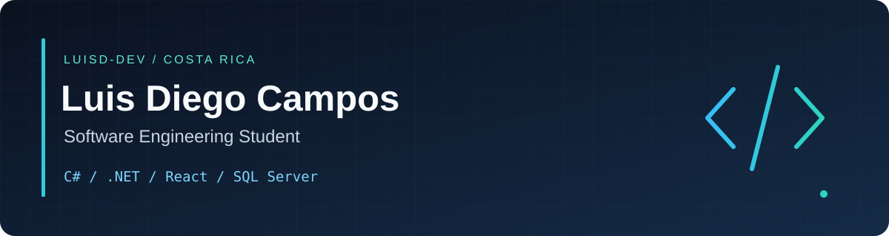

# Building practical software, with quality in mind.

Software Engineering student at **Universidad Técnica Nacional (UTN)**, Costa Rica.  
I develop desktop and web applications, connecting user interfaces, business rules and relational databases.

[Explore my projects](#selected-projects) · [Technical toolkit](#technical-toolkit) · [Visitor hub](#visitor-hub) · [Connect on LinkedIn](https://www.linkedin.com/in/luis-diego-campos-b1225b424)

---

## Selected projects

### 01 / Reservas-Labs
**Web development · Software testing · Team collaboration**

A laboratory reservation system developed for UTN's Software Testing course. Combines a React interface with an ASP.NET Core API and SQL Server.

- Reservation validation: dates, operating hours, maximum duration and overlapping bookings.
- Authentication with user roles and failed login controls.
- Unit testing and documented test cases.

**React · Vite · C# · ASP.NET Core · Entity Framework Core · SQL Server · xUnit**

[Explore source & setup](https://github.com/LuisD-Dev/Reservas-Labs#readme) · [Browse development history](https://github.com/LuisD-Dev/Reservas-Labs/commits/main)

<b>What to look for in this project</b>

 

Follow the flow from a reservation form to backend validation and database persistence. The README documents business rules, test scenarios and local setup.

This is an academic project under continued development. Run it locally using the repository instructions.

### 02 / CondoGest
**Desktop development · Layered architecture · Data management**

A condominium management desktop application covering properties, residents, billing, payments, common-area reservations and reporting.

- Built with WinForms, .NET Framework 4.8, ADO.NET and SQL Server.
- Separates presentation, business logic and data access.
- Includes architecture documentation, technical and user manuals, and verification instructions.

**C# · .NET Framework · Windows Forms · ADO.NET · SQL Server**

[Explore source & setup](https://github.com/LuisD-Dev/CondoGest_ISW524#readme) · [Read the architecture](https://github.com/LuisD-Dev/CondoGest_ISW524/blob/main/ARQUITECTURA.md)

<b>What to look for in this project</b>

 

Explore how application layers divide responsibilities and how database operations support administrative workflows. Start with the architecture guide, then review the technical documentation linked in the README.

This is an academic desktop application. Installation requires Windows, the .NET Framework targeting pack and SQL Server.

### 03 / ProyectoFlota
**In development · Web APIs · Clean Architecture**

An academic vehicle fleet maintenance management project for UTN's Web Programming II course.

The documented architecture separates **Domain**, **Application**, **Infrastructure** and **API** responsibilities.

**Planned stack:** ASP.NET Core · Entity Framework Core · SQL Server · React

[Explore the project](https://github.com/LuisD-Dev/ProyectoFlota#readme) · [Follow development](https://github.com/LuisD-Dev/ProyectoFlota/commits/main)

---

## Technical toolkit

| Area | Technologies and practices |
| :--- | :--- |
| Backend & desktop | C#, .NET, ASP.NET Core, Windows Forms |
| Frontend | JavaScript, React, HTML, CSS, Vite |
| Data | SQL Server, SQL, Entity Framework Core, ADO.NET |
| Quality | xUnit, Postman, validation and documented test cases |
| Architecture | Object-oriented programming, layered architecture, Clean Architecture |
| Collaboration | Git, GitHub, Azure DevOps, Visual Studio, VS Code |

<b>Additional foundations & current learning</b>

 

My academic background also includes Java, C++ and data structures.

I am strengthening my skills in API design, automated testing, database modeling and maintainable software architecture through practical projects and collaborative development.

## How I approach development

**Understand the problem → model the rules → build the solution → validate behavior → document the result.**

My repositories show an ongoing learning process through academic work, implementation decisions and team collaboration.

## Visitor hub

**Choose how you would like to connect.** Everyone can explore; posting requires a GitHub account. Messages are public, so please keep private contact details out of them.

| Say hello | Build something together | Share an idea |
| :--- | :--- | :--- |
| Introduce yourself and tell me what you are working on. | Suggest a project, contribution or technical collaboration. | Ask a question or suggest an improvement to this profile. |
| [Leave a greeting →](https://github.com/LuisD-Dev/LuisD-Dev/issues/new?title=Hello%20from%20a%20visitor&body=Hi%20Luis!%0A%0AWhat%20I%20am%20working%20on%3A%0A%0AHow%20I%20found%20your%20profile%3A%0A%0AA%20message%20for%20you%3A) | [Propose a collaboration →](https://github.com/LuisD-Dev/LuisD-Dev/issues/new?title=Collaboration%20proposal&body=Project%20or%20idea%3A%0A%0AWhat%20we%20could%20build%3A%0A%0ATechnologies%3A%0A%0AHow%20I%20would%20contribute%3A) | [Start a conversation →](https://github.com/LuisD-Dev/LuisD-Dev/issues/new?title=Question%20or%20suggestion&body=My%20question%20or%20idea%3A%0A%0ARelevant%20project%20or%20link%3A) |

[Read visitor conversations](https://github.com/LuisD-Dev/LuisD-Dev/issues) · [Connect privately on LinkedIn](https://www.linkedin.com/in/luis-diego-campos-b1225b424)

<b>I am a recruiter — where should I start?</b>

 

Start with **Reservas-Labs** for full-stack development and software testing, then explore **CondoGest** for desktop development and layered architecture. Each project above links to its source and setup documentation.

My current profile is that of a Software Engineering student, with practical experience through academic and collaborative projects. Connect through LinkedIn to discuss opportunities.

<b>I am a developer — how can I get involved?</b>

 

Explore a project's README, try its local setup and review the code. If you find an improvement, open an issue in that project's repository with the problem, steps to reproduce and expected behavior. For a new idea, use the collaboration link above.

<b>I am learning — what can I explore?</b>

 

- **Frontend + API + database:** explore Reservas-Labs.
- **Desktop workflows + application layers:** explore CondoGest.
- **Architecture in progress:** follow ProyectoFlota.

Open the project details above for a short reading guide. Questions are welcome through the conversation link.

---

### Let's connect

Interested in software development, practical projects and exchanging ideas.

**[LinkedIn ↗](https://www.linkedin.com/in/luis-diego-campos-b1225b424)** · **[All repositories ↗](https://github.com/LuisD-Dev?tab=repositories)** · **[Public activity ↗](https://github.com/LuisD-Dev?tab=overview)**

Learning through practice. Building with purpose.

