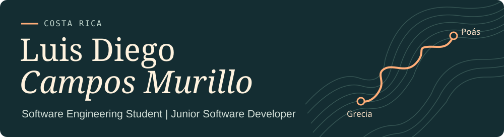

**Software Engineering Student | Junior Software Developer**

[Proyectos](#proyectos) · [Tecnologías](#tecnologías) · [Actividad](#actividad) · [LinkedIn](https://www.linkedin.com/in/luis-diego-campos-b1225b424)

Soy **Luis Diego Campos Murillo**, de Costa Rica, y estoy cursando el bachillerato de Ingeniería del Software en la **Universidad Técnica Nacional**. Me interesa cómo una regla del mundo real se convierte en código: qué pasa cuando dos personas reservan el mismo laboratorio o cómo decide un repartidor qué paquete entregar primero.

## Proyectos

Abrí cada proyecto para ver cómo funciona y qué tecnologías utilicé.

<strong>Mantenimiento de Flota</strong> · API REST para un taller de flota vehicular

Desarrollé esta API con Oscar Rojas García para Programación Web II. Permite registrar órdenes de mantenimiento, consultar las especialidades de cada técnico y encontrar repuestos por debajo del inventario mínimo. Para un mismo repuesto, se puede consultar el precio y el plazo de entrega de cada proveedor.

**C# · ASP.NET Core · EF Core · SQL Server**

[Explorar las 47 operaciones documentadas](https://github.com/LuisD-Dev/ProyectoFlota#api-y-contratos)

<strong>CondoGest</strong> · Administración de condominios desde Windows

La administración puede consultar los cargos, facturas y pagos de una propiedad. También puede reservar áreas comunes y registrar visitas mediante QR. La aplicación separa los formularios, las reglas de negocio y el acceso a SQL Server.

**C# · WinForms · .NET Framework 4.8 · ADO.NET · SQL Server**

[Ver el proyecto](https://github.com/LuisD-Dev/CondoGest_ISW524) · [Recorrer la arquitectura](https://github.com/LuisD-Dev/CondoGest_ISW524/blob/main/ARQUITECTURA.md)

<strong>Reservas-Labs</strong> · Reservas de laboratorios y pruebas de software

Proyecto en equipo para el curso de Pruebas de Software de la UTN. Cuando una persona solicita un laboratorio, la API comprueba el horario, la duración y si la reserva coincide con otra. Trabajamos con pruebas unitarias y casos de prueba vinculados a las historias de usuario.

**React · Vite · ASP.NET Core · SQL Server · xUnit · Azure DevOps**

[Consultar las reglas y pruebas](https://github.com/LuisD-Dev/Reservas-Labs#readme)

<strong>Simulador de mensajería</strong> · Rutas y asignación de paquetes en C++

Modelé las ubicaciones como nodos y las distancias en kilómetros como aristas. Dijkstra calcula la ruta completa del repartidor. El simulador compara dos formas de elegir la siguiente entrega: atender primero los paquetes urgentes y luego por orden de llegada, o elegir el destino más cercano.

Al ejecutar ambas estrategias durante la misma cantidad de *ticks*, puedo comparar paquetes entregados, tiempos de espera y entregas por repartidor.

**C++ · Grafos · Colas de prioridad · Tablas hash**

<strong>Teclia Academia</strong> · Plataforma de aprendizaje con acceso por plan

La plataforma reúne perfiles de estudiantes, carga de contenido y permisos según el plan de cada usuario. El frontend consume una API de Express con autenticación por JWT. Para desarrollo local, el backend puede usar SQLite.

**React · Vite · Node.js · Express · SQLite / PostgreSQL**

[Ver el repositorio](https://github.com/LuisD-Dev/luis-rama/tree/develop) · [Consultar la API](https://github.com/LuisD-Dev/luis-rama/blob/develop/API_DOCUMENTATION.md)

También he trabajado en **Patitas CR**, un sitio web de adopción de mascotas, y en **Chema Style**, una aplicación web con interfaz en React y servicios de datos en Supabase.

## Tecnologías

Para persistencia trabajo con **SQL Server, EF Core y ADO.NET**. Para probar y documentar APIs utilizo **xUnit, Postman y Scalar**.

## Actividad

<strong>Ver contribuciones, lenguajes y estadísticas</strong>

[Explorar mis repositorios públicos](https://github.com/LuisD-Dev?tab=repositories) · [Conectar en LinkedIn](https://www.linkedin.com/in/luis-diego-campos-b1225b424)
